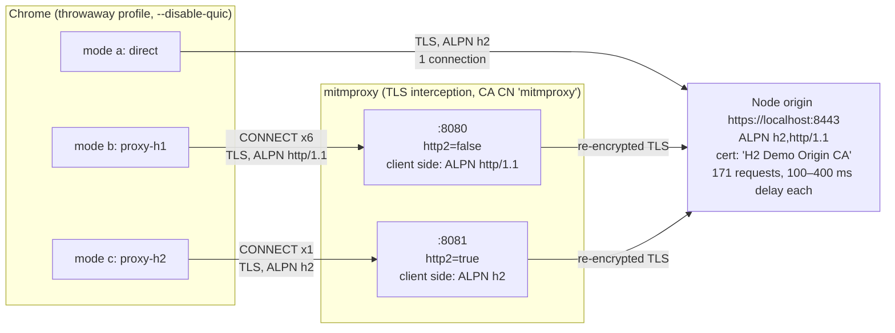

# Six connections and a long queue: how a TLS-inspecting proxy quietly turned HTTP/2 into HTTP/1.1

*Ronald Bradford*

I recently tracked down a performance problem that turned out not to be in the application, the servers, or the CDN. A corporate TLS-inspecting proxy sat between the users and the site. It decrypted every HTTPS connection, inspected it, and re-encrypted it. The site served HTTP/2, but the proxy only spoke HTTP/1.1 to the browser. For a page that made a lot of JavaScript, image and API requests, that one detail was enough to make it painfully slow. Chrome DevTools showed requests spending most of their time in **Stalled**, and the netlog showed why.

This post walks through the background, the symptoms, and a small repo I built to reproduce it on one machine: [github.com/ronaldbradford/http2](https://github.com/ronaldbradford/http2). The repo lets you see the problem, measure it, identify it in a real browser, and confirm the fix. Every number below comes from the repo's `results/` directory, produced by `./run-all.sh 3` in headless Google Chrome 154 on Linux.

The short version: in the demo, the same 171-request page took **~491 ms** direct over HTTP/2, **~7,374 ms** through a proxy that only speaks HTTP/1.1, and **~843 ms** through the same proxy with HTTP/2 turned on, with TLS interception still active.

---

## Background

### HTTP/1.1 vs HTTP/2

With HTTP/1.1, a connection carries one request/response at a time. Keep-alive lets the connection be reused for the next request, but a slow response blocks everything queued behind it on that connection. The only way a browser gets parallelism is to open more connections.

HTTP/2 multiplexes many concurrent streams over a single TCP+TLS connection. Requests and responses are split into frames and interleaved, so one slow API call doesn't hold up a script or an image. The server advertises how many concurrent streams it will accept (`SETTINGS_MAX_CONCURRENT_STREAMS`), which is typically 100 or more.

### ALPN: how the browser and server agree on h2

For HTTPS, the protocol is chosen during the TLS handshake using **ALPN** (Application-Layer Protocol Negotiation). The client offers a list, typically `h2, http/1.1`, and the server picks one. If the server (or whatever terminates TLS) doesn't select `h2`, the browser uses HTTP/1.1 for that connection. No error is shown and nothing breaks. It just goes slower.

### Chrome's per-host connection limit

Chrome limits HTTP/1.1 to **6 connections per host** (strictly, per socket-pool group). The [DevTools Network reference](https://developer.chrome.com/docs/devtools/network/reference) lists this explicitly as a reason a request is Queued or Stalled: "There are already six TCP connections open for this origin, which is the limit. (Applies to HTTP/1.0 and HTTP/1.1 only.)"

So over HTTP/1.1, at most 6 requests to a host are in flight at any moment. Everything else waits. Over HTTP/2, Chrome opens one connection and sends everything on it.

### How TLS-inspecting proxies work, and why they may downgrade

A TLS-inspecting proxy (also called SSL inspection, SSL decryption, or a secure web gateway) is a deliberate man-in-the-middle:

1. The browser connects to the proxy (explicitly, with `CONNECT host:443`, or transparently).
2. The proxy opens its own TLS connection to the real origin and validates the origin's certificate.
3. The proxy presents the browser with a certificate for the same hostname, forged on the fly and signed by the organisation's own CA. Corporate devices trust that CA, so the browser doesn't complain.
4. The proxy decrypts traffic, inspects it, and re-encrypts it in both directions.

There are two TLS connections, and **ALPN is negotiated separately on each one**. The proxy can speak HTTP/2 to the origin and HTTP/1.1 to the browser, or HTTP/1.1 on both. What the browser sees is only what the proxy offers on the client-facing side.

Proxies downgrade for a few common reasons. The inspection engine may only parse HTTP/1.1. HTTP/2 support may exist but be off by default, or switched off at some point because of a compatibility problem. Older appliances or firmware may predate it entirely. The result is the same in every case: the origin supports `h2`, but the browser is offered only `http/1.1`.

---

## The symptoms

What I saw in production:

- A page with many varied requests (bundled and unbundled JS, lots of images, a stream of API calls) was much slower for users on the corporate network than for anyone off it.
- In DevTools → Network, the waterfall looked like a staircase. The Timing tab for later requests showed long **Queueing** and **Stalled** periods, but "Waiting for server response" was small and normal.
- The server's own metrics were fine. Nothing was slow on the origin side.
- The netlog showed sockets stalling on the per-group limit, and the TLS handshake negotiating `http/1.1`.

The server wasn't slow. Requests were waiting for a connection to come free.

---

## The demo

The repo recreates the whole setup on one machine with three modes:

| mode | path | what the browser negotiates |
|---|---|---|
| (a) `direct` | Chrome → origin `https://localhost:8443` | `h2`, 1 connection |
| (b) `proxy-h1` | Chrome → mitmproxy `:8080` (TLS interception, `http2=false`) → origin | `http/1.1`, 6 connections (the problem) |
| (c) `proxy-h2` | Chrome → mitmproxy `:8081` (TLS interception, `http2=true`) → origin | `h2`, 1 connection (the fix) |



### The origin

`origin/server.js` is a Node HTTPS server with no npm dependencies. It uses `http2.createSecureServer` with `allowHTTP1: true`, so ALPN offers both `h2` and `http/1.1`, and it sets `maxConcurrentStreams: 256`.

The test page loads:

- **50** `<script async>` modules,
- **60** small SVG images,
- **60** `fetch()` API calls,

which, with the HTML, makes **171 requests**. Each subresource has a fixed server delay between **100 and 400 ms**. The delay comes from an MD5 hash of the path, so every mode sees exactly the same server latency. The page records `window.__doneMs` once the `load` event has fired, every image has loaded, and every `fetch()` has resolved. That is the "page done" number in the results.

All counts and delays can be tuned with environment variables: `N_JS`, `N_IMG`, `N_API`, `DELAY_MIN`, `DELAY_MAX`.

### The proxy

`scripts/run-proxy.sh` runs `mitmdump` as an explicit proxy with its own CA in `certs/mitmproxy/` (issuer CN `mitmproxy`). The only difference between the "problem" proxy and the "fixed" proxy is a single option:

```bash
# scripts/run-proxy.sh (abridged)
.venv/bin/mitmdump --listen-host 127.0.0.1 --listen-port "$PORT" \
  --set confdir=certs/mitmproxy \
  --set http2="$H2" --set http3=false \
  --set ssl_verify_upstream_trusted_ca=certs/ca.pem \
  --set flow_detail=0 --quiet
```

`h1` sets `http2=false`, and `h2` sets `http2=true`. Interception is active in both. The proxy validates the origin against the demo CA, the same way a corporate proxy validates real origins against public CAs.

### Certificates

`scripts/gen-certs.sh` creates a throwaway "H2 Demo Origin CA" and a `localhost` certificate. To avoid touching any system trust store, the scripts start Chrome with `--ignore-certificate-errors-spki-list=<sha256 of the two demo keys>` and a throwaway `--user-data-dir`. Chrome only honours that flag together with `--user-data-dir`. The README also covers the alternatives: `--ignore-certificate-errors` with a throwaway profile, or temporarily importing both CAs.

Behind a real corporate proxy you need none of this. The corporate CA is already trusted on managed machines.

---

## How to run it

Prerequisites: Node.js 18+ (tested with 20), Python 3.9+ (tested with 3.13), `openssl`, `bash` (on Windows, use WSL), and Google Chrome or Chromium. If neither browser is installed, run `.venv/bin/playwright install chromium`. Set `CHROME=/path/to/chrome` to pick a specific binary. Ports 8443, 8080 and 8081 must be free.

### Automated comparison

```bash
scripts/setup.sh          # once
./run-all.sh 3            # 3 runs per mode, ~40 s; leaves nothing running
```

`scripts/setup.sh` creates `.venv` with mitmproxy, playwright and matplotlib (using `uv` if present, otherwise pip) and generates the certificates. `run-all.sh` starts the origin and both proxies, waits for the ports, runs `measure/measure.py` for each mode, runs `measure/report.py`, and then cleans up.

Tuning:

```bash
N_JS=50 N_IMG=60 N_API=60 DELAY_MIN=100 DELAY_MAX=400 ./run-all.sh
```

### Each mode by hand, to look at it in DevTools

```bash
scripts/run-origin.sh &                         # (all modes)
scripts/run-proxy.sh h1 &                       # (b) downgrading proxy on :8080
PROXY_PORT=8081 scripts/run-proxy.sh h2 &       # (c) fixed proxy on :8081

scripts/chrome.sh direct      # (a)
scripts/chrome.sh proxy-h1    # (b)
scripts/chrome.sh proxy-h2    # (c)
NETLOG=/tmp/h1.json scripts/chrome.sh proxy-h1   # also write a netlog
scripts/stop.sh
```

`scripts/chrome.sh` opens a headed Chrome with DevTools already open. The flags worth knowing:

- `--proxy-server=http://127.0.0.1:8080` (or `:8081`);
- `--proxy-bypass-list=<-loopback>`. Chrome never proxies `localhost` by default, so without this, modes (b) and (c) would quietly go direct;
- `--disable-quic`, so HTTP/3 doesn't get in the way;
- `--ignore-certificate-errors-spki-list=...` and a throwaway `--user-data-dir`.

---

## How to identify it in the browser

You can do all of this on a normal corporate machine with no special setup.

### 1. DevTools → Network: Protocol and Connection ID columns

Right-click any column header and enable **Protocol** and **Connection ID**.

- **Downgraded:** Protocol shows `http/1.1` for a site you know serves `h2`, and only about 6 distinct Connection IDs keep recurring. In the demo's mode (b), the 171 requests were spread over exactly 6 connections, each carrying between 26 and 31 requests.
- **Normal:** `h2` (or `h3`) and a single Connection ID for the host. In modes (a) and (c), all 171 requests used one connection.

DevTools can leave Connection ID blank for some HTTP/1.1 requests. The netlog is the authoritative source.

### 2. The Timing tab: Queueing and Stalled

Click a request late in the waterfall and open **Timing**. The tell-tale pattern is long **Queueing** and/or **Stalled** with a small, normal **Waiting for server response**. The waterfall as a whole looks like a staircase of steps 6 wide.

### 3. Certificate issuer

Click the padlock, look in DevTools → Security, or read `securityDetails.issuer` in CDP. If the issuer is your company's CA or the proxy vendor's CA rather than a public CA, the connection is being intercepted. In the demo, modes (b) and (c) show `mitmproxy` and mode (a) shows `H2 Demo Origin CA`.

From the command line:

```bash
curl -sv --proxy http://proxy:port https://site/ 2>&1 | grep -E 'ALPN|issuer'
```

Through a downgrading proxy, this shows `ALPN: server accepted http/1.1` and the proxy's CA as the issuer.

### 4. chrome://net-export and the netlog viewer

This is the definitive check.

1. Open `chrome://net-export`, start logging (the default capture level is fine, and "Include raw bytes" isn't needed), reproduce the slow page, and stop.
2. Open the file in the netlog viewer at <https://netlog-viewer.appspot.com/>. It's the catapult `netlog_viewer`, it runs client-side only, and nothing is uploaded.
3. Look at:
   - **Events**, filtered by the hostname:
     - `SSL_CONNECT` (the END event) has a `next_proto` param. That is the ALPN result of the TLS handshake with whatever terminated TLS. `"next_proto": "http/1.1"` for an h2 site is the downgrade.
     - `SOCKET_POOL_STALLED_MAX_SOCKETS_PER_GROUP` on the waiting requests. **This is the smoking gun:** the request waited because the host's socket-pool group already had 6 sockets.
     - `HTTP_STREAM_REQUEST_PROTO` shows the `proto` each stream request got.
     - `HTTP_STREAM_JOB_CONTROLLER_PROXY_SERVER_RESOLVED` with `proxy_chain` shows whether a proxy is in the path at all.
   - **Proxy** tab: the effective proxy settings or PAC script.
   - **Sockets** tab: the socket-pool group for the host, with 6 active/idle sockets and pending requests.
   - **HTTP/2** tab: empty for that host when it has been downgraded.

A quick CLI check on the raw file:

```bash
grep -o '"next_proto":"[^"]*"' log.json | sort | uniq -c
```

In the file, event types are stored as numbers, which map to names through `constants.logEventTypes`. `measure/report.py` shows how to decode them.

---

## How the data was captured

`measure/measure.py` drives headless Chrome with Playwright and attaches a Chrome DevTools Protocol (CDP) session to the page. For each run it:

- launches Chrome with `--log-net-log=<file> --net-log-capture-mode=Everything`, the SPKI allow-list, `--disable-quic`, and `--disable-background-networking` plus a few related flags to keep Chrome's own traffic down. For proxy modes it adds `--proxy-server` and `--proxy-bypass-list=<-loopback>`;
- enables `Network.enable` and `Network.setCacheDisabled`;
- records, per request:
  - `Network.requestWillBeSent`: URL, resource type, and `timestamp`;
  - `Network.responseReceived`: `protocol`, `connectionId`, the `timing` object, `securityDetails.issuer`, and `remoteIPAddress`;
  - `Network.loadingFinished`: end timestamp;
- waits for `window.__doneMs`, then reads Resource Timing (`performance.getEntriesByType('resource')`) to get `nextHopProtocol` as an independent cross-check.

The two DevTools timing phases are computed the same way DevTools computes them:

- **Queueing** = `timing.requestTime − requestWillBeSent.timestamp`
- **Stalled** = the first of `proxyStart` / `dnsStart` / `connectStart` / `sendStart` that is set (≥ 0), measured from `requestTime`

"Queueing+Stalled" is the total time before the request was actually sent. In the waterfall chart it is the orange part of each bar.

The Resource Timing `nextHopProtocol` matched the CDP protocol in every mode: `h2` for (a) and (c), and `http/1.1` for (b).

`measure/report.py` then builds `results/comparison.md`, `results/netlog-facts.json` and `results/waterfall.png`. For the netlog, it counts only events from sources related to `localhost:8443`. A source counts as related if its params mention the host, or if a related source links to it through `source_dependency`, which follows the chain from URL request to stream job to socket. This keeps Chrome's own background requests out of the counts.

---

## Results

All numbers are for 171 requests. "Page done" is the time until every script, image and `fetch()` finished. Each mode ran 3 times.

| mode | page done (ms), runs 1 / 2 / 3 | protocol | connection IDs | cert issuer | Stalled sum / median / max (ms), run 1 | Queueing+Stalled sum / median / max (ms), run 1 |
|---|---|---|---|---|---|---|
| (a) direct | 480 / 493 / 491 | h2 | 1 | H2 Demo Origin CA | 3462 / 21.2 / 32 | 7430 / 46.3 / 53 |
| (b) proxy, h1 only | 7374 / 7362 / 7374 | http/1.1 | **6** | **mitmproxy** | 326364 / 1642.9 / 5296 | 605110 / 3547.9 / 7138 |
| (c) proxy, h2 on | 846 / 835 / 843 | h2 | 1 | mitmproxy | 20440 / 37.5 / 363 | 25574 / 63.0 / 406 |

Median page-done across the three runs: **direct 491 ms, proxy-h1 7374 ms, proxy-h2 843 ms**. The runs are very consistent: the h1 mode varied by about 13 ms across three runs.

What that means:

- Through the HTTP/1.1-only proxy, the page took about **15×** as long as direct h2 (7374 / 491).
- The **median** request in mode (b) waited about **3.5 s** before it was even sent. The worst waited 7.1 s.
- Turning on HTTP/2 in the proxy, with interception still active, brought the page back to about **0.84 s**, roughly **9×** faster than the h1 proxy.


The chart shows run 1 of each mode, one bar per request, sorted by start time. Orange is Queueing+Stalled, and blue is the time from sending the request to finishing it. Modes (a) and (c) are short and mostly blue. Mode (b) is almost all orange.

### The server wasn't the problem

Time to first byte (`receiveHeadersEnd − sendStart`) had a median of 255.8 ms direct, 245.4 ms through the h1 proxy, and 292.4 ms through the h2 proxy. Once a request was actually sent, it was answered in about the same time in every mode. The difference is entirely in how long requests waited to be sent.

The arithmetic matches. The server delays for the 170 subresources come from a deterministic hash, and they add up to 42,602 ms (each between 100 and 398 ms). Spread over 6 connections that each handle one request at a time, that is about 42,602 / 6 ≈ 7,100 ms. The measured h1 page time was 7,374 ms. Over h2, all of them run at once, so the page finishes shortly after the slowest response (398 ms). The measured direct time was 480–493 ms.

### Who waits, and where

The netlog and CDP split the wait into two layers, and in mode (b) different resource types got stuck in different places (run 1, medians):

| resource type (count) | Queueing median (ms) | Stalled median (ms) | finished (ms since first request), min / median / max |
|---|---|---|---|
| Fetch (60) | 16.2 | 1231.1 | 212 / 1613 / 2841 |
| Image (60) | 44.4 | 3855.6 | 2752 / 4155 / 5613 |
| Script, async (50) | 6146.2 | 0.4 | 152 / 6394 / 7373 |

The `fetch()` calls got onto the 6 sockets first and finished by about 2.8 s. The images then went through the socket pool, mostly showing as **Stalled**, which is the network-layer per-host limit. The 50 async scripts were mostly held back in **Queueing** by Chrome's renderer-side ResourceScheduler, which restrains lower-priority requests to a host that doesn't support h2. They went last and finished at 7.4 s. Both layers are visible in the netlog, and both disappear with h2.

### Netlog evidence

These counts are from run 1, scoped to `localhost:8443` sources, and include BEGIN/END pairs where applicable:

| event / field | direct | proxy-h1 | proxy-h2 | meaning |
|---|---|---|---|---|
| `SSL_CONNECT` (END) `next_proto` | h2 ×1 | **http/1.1 ×6** | h2 ×1 | ALPN result of each TLS handshake with whatever terminated TLS |
| `HTTP_STREAM_REQUEST_PROTO` `proto` | h2 ×1 | **http/1.1 ×171** | h2 ×1 | over h1, every request goes through a stream request; over h2, later requests reuse the session |
| `SOCKET_POOL_STALLED_MAX_SOCKETS_PER_GROUP` | 0 | **120** | 0 | request waited because the host already had 6 sockets |
| `SOCKET_POOL_STALLED_MAX_SOCKETS` | 0 | 0 | 0 | total pool limit, not hit |
| `SOCKET_POOL_REUSED_AN_EXISTING_SOCKET` | 0 | 165 | 0 | HTTP/1.1 keep-alive reuse of the 6 sockets |
| `RESOURCE_SCHEDULER_REQUEST_STARTED` | 0 | 104 | 0 | renderer ResourceScheduler released a request it was holding (part of the Queueing) |
| `HTTP2_SESSION_INITIALIZED` | 1 | 0 | 1 | one h2 session |
| `HTTP2_SESSION_POOL_FOUND_EXISTING_SESSION` | 170 | 0 | 170 | every other request reused it |
| `HTTP2_SESSION_STALLED_MAX_STREAMS` | 0 | 0 | 87 (`max_concurrent_streams` 100) | h2 stream-limit wait at the proxy (see caveats) |
| `HTTP_STREAM_JOB_CONTROLLER_PROXY_SERVER_RESOLVED` `proxy_chain` | `[direct://]` | `[127.0.0.1:8080]` | `[127.0.0.1:8081]` | shows whether a proxy is in the path |
| `HTTP_TRANSACTION_SEND_TUNNEL_HEADERS` | 0 | 6 | 1 | one `CONNECT localhost:8443` tunnel per TLS connection |

If you only remember two lines from this table: `SSL_CONNECT` with `next_proto: http/1.1` tells you the connection was downgraded, and `SOCKET_POOL_STALLED_MAX_SOCKETS_PER_GROUP` tells you the downgrade is costing you time.

---

## How to unblock it

In order of preference:

### 1. Enable HTTP/2 on the proxy's client-facing side

This is mode (c). If the proxy offers ALPN `h2` to the browser, the browser goes back to a single multiplexed connection and inspection keeps working. In the demo, this is the only change between modes (b) and (c), and it took the page from ~7.4 s to ~0.84 s.

Most current inspecting proxies and secure web gateways can do this, but the setting's name, its default, and whether it applies to the client side, the server side, or both vary by vendor and version. Look in your vendor's documentation for "HTTP/2" under SSL/TLS inspection or decryption settings, and check both legs. In mitmproxy it's `--set http2=true`. After making the change, check the result with the netlog: `SSL_CONNECT` should report `next_proto: h2`.

### 2. Exempt the site from inspection, or bypass the proxy

If the proxy can't do h2, or not yet, two options remove it from the protocol negotiation for specific domains:

- **Do-not-decrypt / SSL-bypass rule:** the proxy tunnels the TLS connection without terminating it, so the browser negotiates ALPN directly with the real origin and gets `h2`.
- **Proxy bypass:** add the domain to the browser or OS proxy bypass list, or return `DIRECT` for it in the PAC file.

Both are security-policy decisions. They belong to the network/security team, and they're reasonable for well-known first-party or SaaS domains that the business already trusts.

### 3. Application-side mitigations

These help everyone stuck behind HTTP/1.1-only middleboxes, whether or not you control the proxy:

- **Make fewer requests.** Bundle JS, use sprites or inline small images, and batch API calls (one request returning many items instead of 60 requests returning one each). In this demo, the 60 `fetch()` calls alone needed 10 rounds of 6.
- **Prioritise what matters.** Use `fetchpriority="high"` and `<link rel="preload">` for critical resources, `loading="lazy"` for non-critical images, and avoid fire-hose `fetch()` loops on page load.
- **Domain sharding as a stopgap.** The 6-connection limit is per host, so spreading static assets and APIs across separate hostnames gives more parallel connections. This is the old HTTP/1.1 trick. It costs extra DNS and TLS handshakes and works against HTTP/2 users, so treat it as temporary.

### A note on HTTP/3 / QUIC

HTTP/3 doesn't help here. Chrome doesn't send origin QUIC through an HTTP (CONNECT) proxy, and inspecting firewalls commonly block UDP/443 so that browsers fall back to TCP, where inspection works. The demo disables QUIC in Chrome and HTTP/3 in mitmproxy to keep the comparison clean.

### If the proxy already speaks h2

Check its `SETTINGS_MAX_CONCURRENT_STREAMS`. A low value causes a milder version of the same stall, which shows up in the netlog as `HTTP2_SESSION_STALLED_MAX_STREAMS`. That's exactly what mode (c) shows; see below.

---

## Caveats

- **Everything runs on loopback.** There is effectively no round-trip time, so the slowdown in mode (b) comes purely from server delay serialised over 6 sockets. On a real WAN, every queued request also pays RTT, which usually makes the downgrade worse, not better.
- **mitmproxy as an h2 proxy advertises `max_concurrent_streams` 100**, as seen in the netlog. With about 170 parallel requests, roughly 70 have to wait for a stream slot, and the netlog recorded `HTTP2_SESSION_STALLED_MAX_STREAMS` 87 times in run 1. That's why mode (c) takes ~843 ms against ~491 ms direct (the origin allows 256 streams). It's still about 9× faster than h1.
- **Queueing in mode (b) has two causes.** The network-layer per-host socket limit (`SOCKET_POOL_STALLED_MAX_SOCKETS_PER_GROUP`) shows mostly as Stalled. Chrome's renderer-side ResourceScheduler holding back low-priority requests to a non-h2 host (`RESOURCE_SCHEDULER_REQUEST_STARTED`) shows mostly as Queueing. Don't expect DevTools to put all of the wait in one bucket.
- **Mode (a) has a non-zero Stalled time** (21–27 ms median across runs) because all requests are issued in one burst while the HTML is still being parsed. It isn't a connection wait.
- **Single platform.** The results come from headless Google Chrome 154 on Linux. Exact milliseconds will vary by machine, but the 6-connection pattern and the netlog events are deterministic.
- **Background traffic.** Chrome's own background requests (to google.com and so on) appear in the raw netlogs. `report.py` excludes them by host-scoping, and `measure.py` reduces them with `--disable-background-networking` and related flags.
- **Netlogs aren't committed.** The `results/netlog-*.json` files are about 3 MB each and are in `.gitignore`. Run `./run-all.sh` to regenerate them along with everything else in `results/`.
- **mitmproxy stands in for a corporate proxy.** It reproduces the mechanism (TLS termination, re-signing with its own CA, ALPN on the client side), not any particular vendor's implementation or defaults.

---

## Conclusion

This was a frustrating problem to find because nothing was broken. The site worked, the certificates validated, and the servers were fast. One ALPN choice in a middlebox took away HTTP/2 multiplexing and put a 6-connection limit in its place, and on a request-heavy page that was the difference between under half a second and over seven seconds.

The things I'd check first next time:

1. DevTools **Protocol** and **Connection ID** columns: `http/1.1` and about 6 recurring connections for a site that serves `h2`.
2. The **certificate issuer**: a corporate or proxy-vendor CA means interception.
3. A **chrome://net-export** capture: `SSL_CONNECT` with `next_proto: http/1.1`, and `SOCKET_POOL_STALLED_MAX_SOCKETS_PER_GROUP` on the waiting requests.

The fix is usually a configuration change on the proxy (enable HTTP/2 on the client side) or a policy decision (don't inspect or don't proxy that domain), not an application rewrite. Reducing request counts is still worth doing, because some of your users are always behind something you don't control.

The repo is at [github.com/ronaldbradford/http2](https://github.com/ronaldbradford/http2). Run `scripts/setup.sh` once, then `./run-all.sh 3` (about 40 seconds), and you can see all of the above on your own machine.
