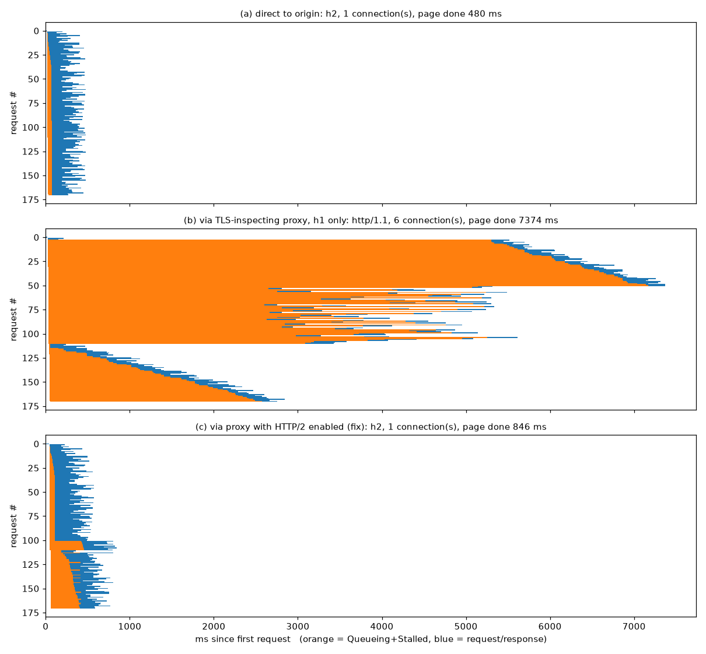

# HTTP/2 → HTTP/1.1 downgrade by a TLS-inspecting proxy: reproducible demo

**The problem:** a corporate TLS-inspecting proxy terminates TLS, re-encrypts with its own CA, and
negotiates only `http/1.1` with the browser (no ALPN `h2`), even though the origin supports HTTP/2.
Chrome allows at most **6 HTTP/1.1 connections per host** (per socket-pool group). On a page that makes
many requests (JS, images, `fetch()` API calls), everything beyond 6 in flight waits, so DevTools
shows long **Queueing/Stalled** bars. Over HTTP/2, all requests are multiplexed on **one** connection.

This demo builds that setup on one machine:

| mode | path | what the browser negotiates |
|---|---|---|
| (a) `direct` | Chrome → origin `https://localhost:8443` | `h2`, 1 connection |
| (b) `proxy-h1` | Chrome → mitmproxy `:8080` (TLS interception, `http2=false`) → origin | `http/1.1`, 6 connections ← the problem |
| (c) `proxy-h2` | Chrome → mitmproxy `:8081` (TLS interception, `http2=true`) → origin | `h2`, 1 connection ← the fix |

The origin (`origin/server.js`, Node with no npm packages) offers ALPN `h2,http/1.1`. Its test page loads
**50 async scripts + 60 images + 60 `fetch()` calls** (171 requests, including the HTML). Each
subresource has a fixed server delay between 100 and 400 ms, picked from a hash of its path, so
every mode sees the same server latency.

## Files

```
run-all.sh              # start everything, measure all 3 modes in headless Chrome, write report, stop everything
scripts/setup.sh        # one-time: .venv (mitmproxy, playwright, matplotlib) + certs
scripts/gen-certs.sh    # local "H2 Demo Origin CA" + localhost cert (certs/)
scripts/run-origin.sh   # HTTPS origin on :8443 (h2 + http/1.1)
scripts/run-proxy.sh    # mitmproxy explicit proxy: `h1` (on :8080) or `PROXY_PORT=8081 ... h2`
scripts/chrome.sh       # headed Chrome, throwaway profile, pointed at a mode (for DevTools)
scripts/stop.sh         # kill origin/proxies
origin/server.js
measure/measure.py      # Playwright + CDP: per-request protocol, connection id, Queueing/Stalled; writes netlog
measure/report.py       # results/comparison.md, results/netlog-facts.json, results/waterfall.png
results/                # output of the last run (see below)
```

## Prerequisites (box or laptop)

- Node.js 18+ (tested with 20), Python 3.9+ (tested with 3.13), `openssl`, and `bash`. On Windows, use WSL.
- Google Chrome or Chromium. If neither is installed, run `.venv/bin/playwright install chromium`.
  Set `CHROME=/path/to/chrome` to pick a specific binary. macOS Chrome is detected automatically by `scripts/chrome.sh`.
- `scripts/setup.sh` creates `.venv` with mitmproxy, playwright and matplotlib. It uses `uv` if present, otherwise pip.
- Ports 8443, 8080 and 8081 must be free.

## Run it

### Automated comparison (one command)

```bash
scripts/setup.sh          # once
./run-all.sh 3            # 3 runs per mode, ~40 s; leaves nothing running
```
Tuning via env: `N_JS=50 N_IMG=60 N_API=60 DELAY_MIN=100 DELAY_MAX=400 ./run-all.sh`.

### Each mode by hand (to look at it in DevTools)

```bash
scripts/run-origin.sh &                         # (all modes)
scripts/run-proxy.sh h1 &                       # (b) downgrading proxy on :8080
PROXY_PORT=8081 scripts/run-proxy.sh h2 &       # (c) fixed proxy on :8081

scripts/chrome.sh direct      # (a)
scripts/chrome.sh proxy-h1    # (b)
scripts/chrome.sh proxy-h2    # (c)
NETLOG=/tmp/h1.json scripts/chrome.sh proxy-h1   # also write a netlog
scripts/stop.sh
```
`scripts/chrome.sh` starts Chrome with:
- a throwaway `--user-data-dir`;
- `--proxy-server=http://127.0.0.1:8080` (or `:8081`);
- `--proxy-bypass-list=<-loopback>`, which is needed because Chrome otherwise never proxies `localhost`;
- `--disable-quic`;
- `--ignore-certificate-errors-spki-list=<sha256 of the two demo keys>`.

**Certificates / trust options:** the origin cert is signed by `certs/ca.pem` ("H2 Demo Origin CA").
The proxy re-signs everything with `certs/mitmproxy/mitmproxy-ca-cert.pem` (issuer CN "mitmproxy"),
the same way a corporate proxy uses its own CA. Pick one of these:
1. **Recommended:** use the SPKI allow-list as `chrome.sh` does. It changes no system state, and Chrome
   requires `--user-data-dir` for it.
2. `--ignore-certificate-errors` with a throwaway `--user-data-dir`. This is blunter; never use it with your real profile.
3. Import `certs/ca.pem` and `certs/mitmproxy/mitmproxy-ca-cert.pem` into the OS or Chrome trust store
   (macOS Keychain → "Always Trust"; Linux `certutil -d sql:$HOME/.pki/nssdb -A -t C,, -n h2demo -i <pem>`).
   Remove them afterwards.

Behind a real corporate proxy, you don't need any of this. Open a normal Chrome on the corporate network
and follow "How to identify it".

## Measured results (this box, headless Google Chrome 154, `./run-all.sh 3`)

Full table: `results/comparison.md`. Chart: `results/waterfall.png`.

| mode | page done (ms), 3 runs | protocol | connection IDs | cert issuer | Stalled sum / median / max (ms) | Queueing+Stalled sum / median / max (ms) |
|---|---|---|---|---|---|---|
| (a) direct | 480 / 493 / 491 | h2 | 1 | H2 Demo Origin CA | 3462 / 21 / 32 (run 1) | 7430 / 46 / 53 |
| (b) proxy, h1 only | 7374 / 7362 / 7374 | http/1.1 | **6** | **mitmproxy** | 326364 / 1643 / 5296 | 605110 / 3548 / 7138 |
| (c) proxy, h2 on | 846 / 835 / 843 | h2 | 1 | mitmproxy | 20440 / 38 / 363 | 25574 / 63 / 406 |

Every number is for 171 requests. "page done" is the time until every script, image and `fetch()` has finished.
In mode (b) the median request waited **~3.5 s** before it was even sent, and the page took **~15×** as long as
direct h2. Turning HTTP/2 on in the proxy, with interception still active, brings it back to ~0.84 s.

How the timing values are computed (`measure/measure.py`, from CDP `Network.responseReceived.timing`, matching DevTools):
- Queueing = `timing.requestTime − requestWillBeSent.timestamp`
- Stalled = the first of `proxyStart`/`dnsStart`/`connectStart`/`sendStart`, measured from `requestTime`

Resource Timing `nextHopProtocol` (in `results/requests-*.json`) agrees with the CDP protocol value.



## Netlog evidence (what to search for)

`report.py` only counts netlog events from sources related to `localhost:8443`. This keeps out Chrome's own
background traffic. The counts are from run 1 and include BEGIN/END pairs.

| event / field | direct | proxy-h1 | proxy-h2 | meaning |
|---|---|---|---|---|
| `SSL_CONNECT` (END) param `next_proto` | h2 ×1 | **http/1.1 ×6** | h2 ×1 | ALPN result of each TLS handshake with whatever terminated TLS |
| `HTTP_STREAM_REQUEST_PROTO` param `proto` | h2 | **http/1.1 ×171** | h2 | protocol each stream request got |
| `SOCKET_POOL_STALLED_MAX_SOCKETS_PER_GROUP` | 0 | **120** | 0 | **request waited because the group (host) already had 6 sockets**. This is the smoking gun |
| `SOCKET_POOL_STALLED_MAX_SOCKETS` | 0 | 0 | 0 | total pool limit (not hit here) |
| `SOCKET_POOL_REUSED_AN_EXISTING_SOCKET` | 0 | 165 | 0 | h1 keep-alive reuse of the 6 sockets |
| `RESOURCE_SCHEDULER_REQUEST_STARTED` | 0 | 104 | 0 | renderer-side ResourceScheduler released a request it was holding. Seen only for the h1 host; this is part of the long "Queueing" |
| `HTTP2_SESSION_INITIALIZED` / `HTTP2_SESSION_POOL_FOUND_EXISTING_SESSION` | 1 / 170 | 0 / 0 | 1 / 170 | one h2 session, reused for every request |
| `HTTP2_SESSION_STALLED_MAX_STREAMS` param `max_concurrent_streams` | 0 | 0 | 87 (limit 100) | h2 stream-limit wait (see caveats) |
| `HTTP_STREAM_JOB_CONTROLLER_PROXY_SERVER_RESOLVED` param `proxy_chain` | `[direct://]` | `[127.0.0.1:8080]` | `[127.0.0.1:8081]` | shows a proxy is in the path |
| `HTTP_TRANSACTION_SEND_TUNNEL_HEADERS` (`CONNECT localhost:8443 HTTP/1.1`) | 0 | 6 | 1 | one CONNECT tunnel per TLS connection |

Netlogs are in `results/netlog-<mode>-run<N>.json`, about 3 MB each.

## How to identify it in a real browser

1. **DevTools → Network.** Right-click a column header and enable **Protocol** and **Connection ID**.
   - Problem: Protocol is `http/1.1` for a site you know serves `h2`, and there are only ~6 distinct Connection IDs
     that keep recurring.
   - Normal: `h2` (or `h3`), with one Connection ID for the host.
   - DevTools docs note that Connection ID can be blank for some HTTP/1.1 requests. The netlog is the authoritative source.
2. **Timing tab** of a late request: long **Queueing** and/or **Stalled**, with small "Waiting for server response".
   Per the [DevTools reference](https://developer.chrome.com/docs/devtools/network/reference), Queueing/Stalled
   includes "There are already six TCP connections open for this origin, which is the limit. (Applies to HTTP/1.0 and HTTP/1.1 only.)"
   The waterfall looks like a staircase of 6-wide steps.
3. **Certificate issuer:** click the padlock (or DevTools → Security, or `securityDetails.issuer` in CDP).
   If the issuer is your company's CA or the proxy vendor's CA rather than a public CA, the connection is being intercepted.
   Here it shows `mitmproxy`, not `H2 Demo Origin CA`.
   CLI check: `curl -sv --proxy http://proxy:port https://site/ 2>&1 | grep -E 'ALPN|issuer'` shows
   `ALPN: server accepted http/1.1` and the proxy CA.
4. **chrome://net-export.** Start logging (the default level is fine; "Include raw bytes" isn't needed), reproduce, then stop.
   Open the file in the netlog viewer at <https://netlog-viewer.appspot.com/> (catapult `netlog_viewer`; it runs
   client-side only, and nothing is uploaded). Look at:
   - **Events**, filtered by the hostname: `SSL_CONNECT` (END) with `"next_proto": "http/1.1"` and
     `SOCKET_POOL_STALLED_MAX_SOCKETS_PER_GROUP` on the stalled requests. `HTTP_STREAM_REQUEST_PROTO` shows `proto`.
   - **Proxy** tab: the effective proxy settings or PAC.
   - **Sockets** tab: the socket pool group for the host, with 6 active/idle sockets and pending requests.
   - **HTTP/2** tab: empty for that host when downgraded.
   - Quick CLI check: `grep -o '"next_proto":"[^"]*"' log.json | sort | uniq -c`. Event names are numeric in the
     file and mapped through `constants.logEventTypes`; `measure/report.py` shows how to decode them.

## How to unblock it

1. **Turn on HTTP/2 on the proxy's client-facing side** (ALPN `h2` to the browser). This is mode (c). Most
   current inspecting proxies and secure web gateways can do it, but the setting name and default vary by vendor and
   version, so check your vendor's docs for "HTTP/2" under SSL/TLS inspection. Here it's mitmproxy `--set http2=true`.
2. **Exempt the domain from TLS inspection** (an SSL-bypass or "do not decrypt" rule), or **bypass the proxy** for it
   (proxy bypass list, or `DIRECT` in the PAC file). The browser then negotiates ALPN with the real origin and gets h2.
   This is a security-policy decision for the network team.
3. **App-side mitigations** (help everyone stuck behind h1-only middleboxes):
   - Make fewer requests: bundle JS, use sprites or inline small images, batch API calls (one request returning many items).
   - Prioritise critical requests, e.g. with `fetchpriority="high"`, `<link rel="preload">`, deferring or lazy-loading
     non-critical images (`loading="lazy"`), and avoiding fire-hose `fetch()` loops.
   - As a stopgap, spread static assets and APIs across separate hostnames, because the 6-connection limit is per host
     (per socket-pool group). This is the old "domain sharding" trick. It costs extra DNS/TLS handshakes and hurts h2
     users, so treat it as temporary.
   - **HTTP/3 doesn't help here.** Chrome doesn't send origin QUIC through an HTTP (CONNECT) proxy, and
     inspecting firewalls commonly block UDP/443 so browsers fall back to TCP, where inspection works.
4. If the proxy does speak h2, look at its `SETTINGS_MAX_CONCURRENT_STREAMS`. A low value causes a milder version of
   the same stall (`HTTP2_SESSION_STALLED_MAX_STREAMS`).

## Caveats

- **Everything runs on loopback.** There is effectively no RTT, so the slowdown comes from server delay and
  serialisation over 6 sockets. On a real WAN, every queued request also pays RTT, which usually makes things worse.
- **Queueing in mode (b) has two causes.** One is the network-layer per-host limit
  (`SOCKET_POOL_STALLED_MAX_SOCKETS_PER_GROUP`, which DevTools mostly shows as Stalled). The other is Chrome's
  renderer-side ResourceScheduler holding back lower-priority requests to a host without h2
  (`RESOURCE_SCHEDULER_REQUEST_STARTED`, which DevTools shows as Queueing). Both disappear with h2.
- **mitmproxy as an h2 proxy** advertises `max_concurrent_streams` 100 (seen in the netlog). With 170 parallel
  requests, about 70 wait for a stream slot, which is why (c) is ~0.84 s against ~0.49 s for direct (origin allows 256).
  It's still ~9× faster than h1.
- **The "Stalled" sum** in mode (a) is non-zero (~20–40 ms median) because all requests are issued in one
  burst while the HTML is still parsing. It isn't a connection wait.
- **Results come from headless Chrome 154 on Linux.** Exact ms will vary by machine, but the 6-connection pattern
  and netlog events are deterministic.
- **Background requests are excluded.** Chrome's own background requests (google.com etc.) appear in the raw netlogs.
  `report.py` excludes them by host-scoping, and `measure.py` reduces them with `--disable-background-networking` and similar flags.
